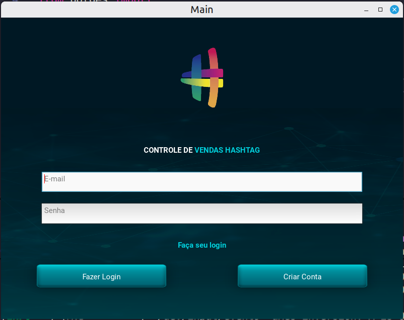
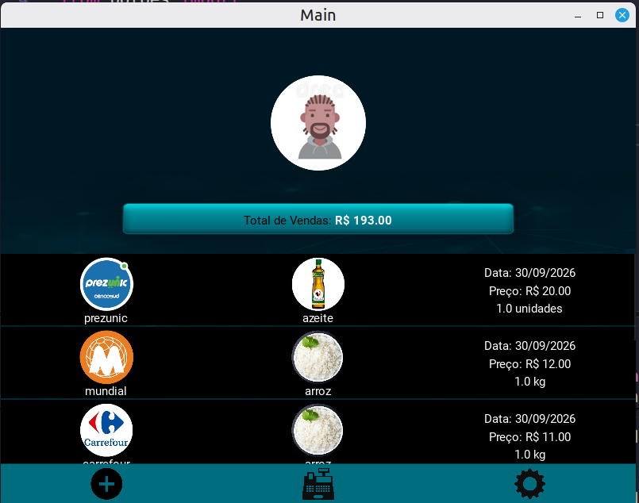
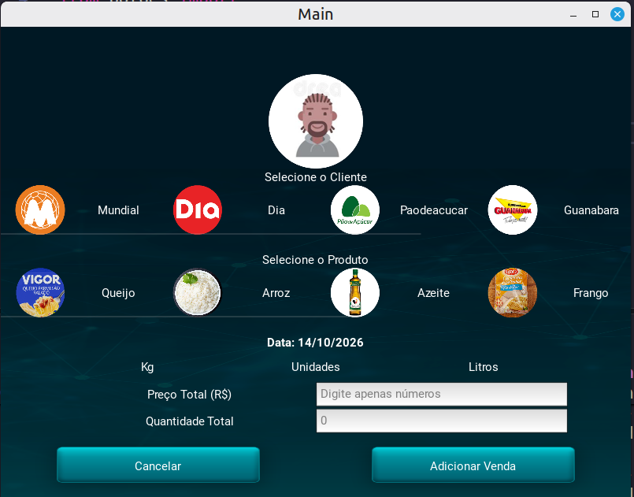
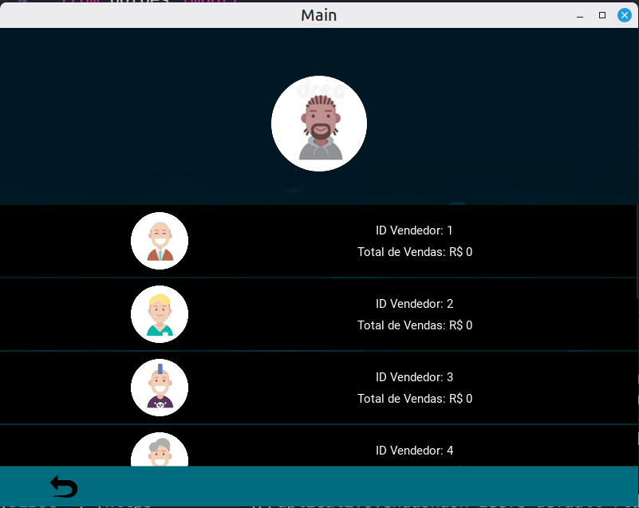
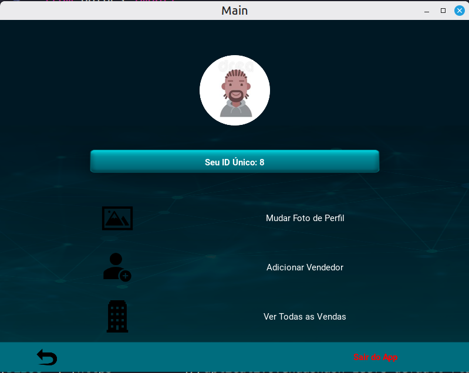

# App de Vendas - Supermercados

Aplicativo de vendas de insumos para redes de supermercado.

---

## Demonstração







---

## Tecnologias

Este projeto foi desenvolvido utilizando as seguintes tecnologias:

- **Python 3.12.3**
- **Kivy**
- **Firebase REST API**

---

## Funcionalidades

- [x] Cadastro e autenticação de usuários
- [x] Adição de novas vendas
- [x] Acompanhamento de vendas de vendedores da equipe
- [x] Acompanhamento de vendas totais da empresa
- [x] Ajuste de foto (avatar) do perfil do usuário

---

## Como Executar o Projeto

### Pré-requisitos

Antes de começar, você precisará ter instalado em sua máquina:
- [Git](https://git-scm.com)
- [Python 3.12](https://www.python.org/)

### Passo a Passo

1. **Clone este repositório:**
   ```bash
   git clone https://github.com/Brazil25/app_vendas
   ```

2. **Acesse a pasta do projeto:**
   ```bash
   cd app_vendas
   ```

3. **Crie e ative o ambiente virtual (opcional, mas recomendado):**
   ```bash
   python -m venv venv
   source venv/bin/activate  # Linux/Mac
   # ou: venv\Scripts\activate  # Windows
   ```

4. **Instale as dependências:**
   ```bash
   pip install -r requirements.txt
   ```

5. **Execute a aplicação:**
   ```bash
   python main.py
   ```

---

## Licença

Este projeto está sob a licença MIT.
